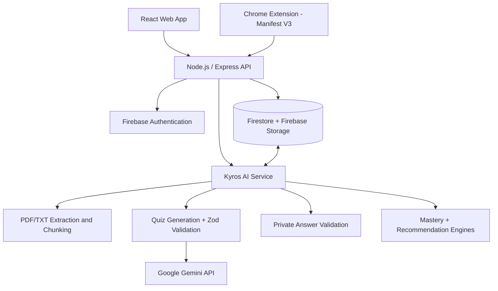

<div align="center">


# KYROS

### Turn Distraction into Mastery.

**An AI-powered digital wellbeing and personalized learning companion.**

Kyros combines a React study experience, an optional Chrome extension, and a Node.js AI engine to transform moments of digital distraction into meaningful learning opportunities.

[Explore the Repository](https://github.com/ChampionUgrax/Kyros) · [Report an Issue](https://github.com/ChampionUgrax/Kyros/issues) · [Contribute](#contributing)


[](./LICENSE)

**Built for SPHINX'26 at MNIT Jaipur**

</div>

> **Project status:** The standalone AI modules have been developed and locally tested, including Gemini-powered question generation from a text-based PDF. The shared Express/Firebase APIs, React application, and Chrome extension still require integration and end-to-end validation. Features labeled **Planned / Integration** below describe the intended product, not a claim that the whole app is deployed.

---

## Table of Contents

- [The Problem](#the-problem)
- [Our Solution](#our-solution)
- [Core Features](#core-features)
- [How Kyros Works](#how-kyros-works)
- [Architecture](#architecture)
- [The AI Engine](#the-ai-engine)
- [Technology Stack](#technology-stack)
- [Repository and AI Module Structure](#repository-and-ai-module-structure)
- [Getting Started](#getting-started)
- [Running Tests](#running-tests)
- [Proposed Backend API](#proposed-backend-api)
- [Security and Privacy](#security-and-privacy)
- [Current Progress](#current-progress)
- [Roadmap](#roadmap)
- [Team Responsibilities](#team-responsibilities)
- [Contributing](#contributing)
- [License](#license)

## The Problem

Students face two interconnected challenges:

1. **Digital distraction.** Social media, short-form video feeds, and endless scrolling interrupt focused study sessions. Conventional blockers can reduce access, but they rarely help students recover their learning momentum.
2. **One-size-fits-all revision.** Static quizzes and generic resources do not adapt to a student's own notes, misconceptions, or weak areas.

A typical student may have excellent course material but no convenient way to turn it into short, relevant practice at the moment when motivation slips.

## Our Solution

**Kyros turns distraction attempts into opportunities to learn.**

Students can upload course notes, practice AI-generated multiple-choice questions, and receive guided feedback. During an active focus session, an optional Chrome extension can intercept configured distracting destinations and present a brief challenge based on the learner's material.

A successful answer may qualify the student for a **short, policy-controlled break** (for example, three minutes), while a wrong answer provides a Socratic hint and contributes to topic-level learning insights. Break eligibility and duration must be decided by the trusted backend, not by the browser or AI model.

**The goal is not simply to block distractions; it is to redirect attention toward measurable learning.**

## Core Features

| Capability | What it does | Status |
| --- | --- | --- |
| Notes ingestion | Extracts selectable text from `.pdf` and `.txt` study material | **AI module tested** |
| Gemini question generation | Produces a notes-based MCQ with four answer options | **AI module tested** |
| Socratic hints and explanations | Generates a guiding hint and a reasoned explanation with each question | **AI module tested** |
| Structured quiz validation | Uses JSON Schema and Zod to check quiz shape and option constraints | **AI module tested** |
| Answer checking | Validates mock quizzes and supports checking generated quizzes against private answer records | **Local logic implemented** |
| Topic mastery analysis | Classifies performance as `CRITICAL`, `REVIEW`, `MASTERED`, or `UNASSESSED` | **Local logic tested** |
| Adaptive study recommendations | Prioritizes weaker topics using quiz-attempt history | **Local logic tested** |
| Mock question bank | Supplies predefined questions independent of Gemini availability | **Local module tested** |
| Student dashboard | Displays practice, progress, and recommendations | **Integration** |
| Focus-session companion | Presents learning challenges through an optional Chrome extension | **Integration** |
| Firebase persistence | Stores authorized materials, private quizzes, attempts, and progress | **Integration** |
| Secure break rewards | Issues time-limited access according to backend policy | **Integration** |

## How Kyros Works

### 1. Learn from your own material

1. Sign in to the Kyros web application.
2. Upload a text-based course PDF or TXT file.
3. The backend extracts and cleans readable text and prepares manageable content chunks.
4. Gemini uses relevant study context to generate a multiple-choice question.
5. The system validates the question format before presenting it to the learner.

### 2. Practice with guided feedback

1. The website or extension requests a quiz through the same backend API.
2. The student receives the question and four choices **without** the answer key.
3. The student selects an answer and submits it to the server.
4. The server looks up the stored private answer, checks the selection, and records the attempt.
5. Wrong responses receive a Socratic hint; correct responses receive an explanation.
6. Recorded attempts can update the learner's topic mastery and next-study recommendation.

### 3. Replace distraction with a challenge

In the proposed focus workflow, the Chrome extension watches only user-configured distracting destinations **locally** while focus mode is active. When the user attempts to visit one of these destinations, the extension can show a Kyros challenge instead of immediately opening the site.

The extension requests a ready-to-use quiz, displays it, and sends the student's selected option to the server. The backend determines whether the answer qualifies for a permitted short break. To keep challenges responsive, production integration should **pre-generate/cache questions** rather than call Gemini on every blocked navigation.

The extension does **not** need to send raw browsing history or visited URLs to Gemini or the Kyros backend.

## Architecture

Kyros follows a **modular monolith** approach centered on Node.js and Express. The AI service is a set of reusable server-side modules rather than a separate Python service or a model running inside the extension.



**Ownership boundary:** The React app and extension display the user experience. Express handles authentication, resource ownership, persistence, scoring, and reward authorization. The AI service handles study-material processing, question generation, answer-checking logic, and learning recommendations.

## The AI Engine

The standalone AI engine is written in JavaScript using Node.js ES modules and the Google GenAI SDK.

### Document processing

`src/notesProcessor.js` provides:

- `extractNotes(filePath)` — reads a local `.txt` or text-based `.pdf` file, limits the input size, and extracts readable text.
- `cleanText(text)` — normalizes whitespace and line breaks.
- `chunkNotes(text, maxChars, overlap)` — divides extracted notes into overlapping segments so context can be carried across chunk boundaries.

The current implementation supports **selectable-text PDFs**, not scanned/image-only PDFs; OCR is a future enhancement. The current generator uses an initial excerpt of supplied text, so selecting the most relevant topic-specific chunks is also a planned improvement.

### Gemini-powered quiz generation

`src/gemini.js` initializes the SDK using a **server-side** `GEMINI_API_KEY`. `src/quizGenerator.js` sends a short, notes-grounded prompt to Gemini and requests structured JSON containing:

```json
{
  "question": "Which access principle is exploited by LRU?",
  "options": [
    "Temporal locality",
    "Spatial locality",
    "Circular locality",
    "Sequential locality"
  ],
  "correct_index": 0,
  "socratic_hint": "Consider which past accesses are useful for predicting near-future accesses.",
  "explanation": "LRU uses recent access history, reflecting temporal locality."
}
```

The output is checked against the local Zod quiz schema, assigned server-owned identifiers, and split into:

- **`publicQuiz`** — question, options, and safe metadata sent to clients.
- **`privateQuiz`** — includes the correct index, hint, and explanation, and must remain on the trusted server.

The AI engine has been locally tested with **Gemini 3.5 Flash-Lite**. One successful PDF-to-question run took **1.63 seconds**; this is a single development measurement, not a service-level performance guarantee.

**Important:** Zod validates the output *structure*, not whether every question or distractor is academically correct. Production quality requires additional review and grounding checks.

### Answer validation

`src/answerValidator.js` contains:

- `validateAnswer(quizId, selectedIndex)` — looks up and checks a predefined mock question.
- `validateGeneratedAnswer(privateQuiz, selectedIndex)` — compares an answer against a previously generated **private** quiz record.

The generated private record must be loaded by the backend using an authenticated student context; **clients must never submit a `privateQuiz` or a claimed `correct_index`**.

### Mastery and adaptive recommendations

`src/masteryEngine.js` analyzes distinct first-attempt results by topic and computes:

```text
Accuracy = (Correct first attempts / Distinct quiz attempts) × 100
```

| Accuracy | Status | Learning action |
| --- | --- | --- |
| Below 50% | `CRITICAL` | Prioritize revision |
| 50–80% | `REVIEW` | Continue targeted practice |
| Above 80% | `MASTERED` | Consider advanced questions |
| No attempts | `UNASSESSED` | Collect initial evidence |

Results based on fewer than five distinct quizzes are provisional. `src/recommendationEngine.js` ranks weaker topics ahead of mastered topics and suggests a next topic and difficulty.

These recommendations are **transparent, rule-based personalization**; they are not predictions from a separately trained ML model.

### Unified service interface

`src/aiService.js` exposes reusable functions for the Express backend:

```js
getQuiz(topicId)                         // Public mock question
getAIQuizFromNotes(notesText, topicId, topicName)
getAIQuizFromFile(filePath, topicId, topicName)
submitQuizAnswer(quizId, selectedIndex)  // Mock bank only
getStudyPlan(attempts, topics)
processStudyMaterial(filePath)
```

The backend uses `validateGeneratedAnswer()` with its privately stored quiz record for real Gemini-generated questions.

### Why Node.js instead of Python?

Kyros primarily orchestrates **API calls, uploads, validation, and database access**, rather than training a custom neural network. Node.js allows these components to live in the same JavaScript ecosystem as Express, making integration with the React site and extension simpler during a hackathon. Gemini performs inference remotely on Google's infrastructure; the language of the backend does not change that model's capabilities. Python remains a strong option for future custom ML, advanced OCR, or a separate retrieval service.

## Technology Stack

| Layer | Technology |
| --- | --- |
| Web application | React |
| Browser companion | Chrome Extension, Manifest V3 |
| API server | Node.js, Express |
| Authentication | Firebase Authentication |
| Database | Cloud Firestore |
| File storage | Firebase Storage |
| Generative AI | Google Gemini via `@google/genai` |
| Validation | Zod and structured JSON output |
| File extraction | `pdf-parse`, Node.js file APIs |
| Source control | Git and GitHub |

## Repository and AI Module Structure

The public `main` branch and the in-progress feature branches may have different layouts while the team merges its work. The following shows the **AI workspace** that has been developed and tested; it is not a claim that every folder is already on `main`.

```text
Kyros/
├── Kyros_logo.svg
├── README.md
├── LICENSE
└── [AI workspace / AI branch]
    ├── package.json
    ├── package-lock.json
    ├── .env                 # local only; never commit
    ├── data/
    │   ├── sampleNotes.txt
    │   ├── sampleQuestions.js
    │   └── courseNotes.pdf
    ├── src/
    │   ├── aiService.js
    │   ├── gemini.js
    │   ├── quizGenerator.js
    │   ├── mockQuizGenerator.js
    │   ├── quizSchema.js
    │   ├── answerValidator.js
    │   ├── notesProcessor.js
    │   ├── masteryEngine.js
    │   ├── recommendationEngine.js
    │   └── hintGenerator.js
    └── tests/
        ├── testQuiz.js
        ├── testNotes.js
        ├── testGemini.js
        └── testIntegration.js
```

## Getting Started

> These steps run the **AI workspace locally**. The full React/Express/Firebase application will have additional setup once the teams' branches are merged.

### Prerequisites

- Git
- Node.js **24** (the version used in local tests) and npm
- A Gemini API key from [Google AI Studio](https://aistudio.google.com/api-keys)
- For PDF tests, a local PDF containing selectable text

### 1. Clone the repository

```bash
git clone https://github.com/ChampionUgrax/Kyros.git
cd Kyros
```

Switch to the AI feature branch if its changes have not been merged:

```bash
git switch ai
```

Run the remaining commands from **the directory containing the AI `package.json`**. The repository layout may change after integration.

### 2. Install dependencies

```bash
npm install
```

### 3. Configure environment variables

Create a local `.env` file next to the AI package's `package.json`:

```dotenv
GEMINI_API_KEY=YOUR_GEMINI_API_KEY
GEMINI_MODEL=gemini-3.5-flash-lite
```

Replace the placeholder with your own key. Do not paste a key into issues, screenshots, frontend code, commits, or this README. Never commit `.env` or `node_modules`.

Example `.gitignore` entries:

```gitignore
.env
node_modules/
*.log
```

### 4. Run the AI modules

The project currently runs its core workflows through test scripts; a standalone web server is not started by these commands.

```bash
node tests/testQuiz.js
node tests/testNotes.js
node tests/testIntegration.js
```

To make a real Gemini request in **Git Bash**:

```bash
NODE_USE_ENV_PROXY=1 NODE_OPTIONS=--dns-result-order=ipv4first node --env-file=.env tests/testGemini.js
```

The proxy and DNS flags helped in the original development environment; other networks may not need them. The test requires a valid key, network access, and quota.

### 5. Test real PDF extraction

Place a selectable-text PDF at `data/courseNotes.pdf`, then run:

```bash
node --input-type=module -e '
import { extractNotes } from "./src/notesProcessor.js";
const notes = await extractNotes("data/courseNotes.pdf");
console.log({ filename: notes.filename, pages: notes.pages, characters: notes.characters });
console.log(notes.text.slice(0, 250));
'
```

Run the PDF-to-Gemini pipeline through the service:

```bash
NODE_USE_ENV_PROXY=1 NODE_OPTIONS=--dns-result-order=ipv4first node --env-file=.env --input-type=module -e '
import { getAIQuizFromFile } from "./src/aiService.js";
const { publicQuiz } = await getAIQuizFromFile("data/courseNotes.pdf", "os_lru", "LRU Page Replacement");
console.log(publicQuiz);
'
```

## Running Tests

| Command | Verification |
| --- | --- |
| `node tests/testQuiz.js` | Mock quiz generation, answer validation, mastery, recommendations |
| `node tests/testNotes.js` | Text notes extraction and chunking |
| `node tests/testIntegration.js` | Unified AI service and local mock workflows |
| `node --env-file=.env tests/testGemini.js` | Live Gemini question generation |

**Testing boundary:** A passing local test does not mean authentication, Firestore persistence, rewards, or extension interception have been integrated. Those require separate API and end-to-end tests.

## Proposed Backend API

The following describes **integration contracts to align with the backend developer**; routes and payloads should be finalized against the shared Express implementation.

### `POST /api/materials`

Authenticated multipart upload of a permitted PDF/TXT file. The backend verifies ownership, stores the file securely, extracts readable content, and creates a material record. Return metadata such as `material_id`, `filename`, and extraction status.

### `POST /api/ai/generate-quiz`

**Request** (illustrative):

```json
{
  "material_id": "material_123",
  "topic_id": "os_lru",
  "topic_name": "LRU Page Replacement"
}
```

The backend loads the user's authorized material, invokes `getAIQuizFromNotes()`, stores `privateQuiz`, and returns **only** `publicQuiz`.

**Response** (illustrative):

```json
{
  "quiz_id": "ai_123",
  "topic_id": "os_lru",
  "topic_name": "LRU Page Replacement",
  "question": "Which page does LRU replace?",
  "options": [
    "The newest page",
    "The least recently accessed page",
    "The largest page",
    "The most frequently accessed page"
  ]
}
```

### `POST /api/quizzes/:id/submit`

**Request** (illustrative):

```json
{
  "selected_index": 1,
  "attempt_id": "unique_attempt_id"
}
```

The server verifies the user, checks quiz ownership, loads the private answer key, validates the response, and writes an idempotent attempt. A wrong response may include `socratic_hint`; a correct response may include `explanation`. Any reward is independently authorized by backend focus-session policy.

### `GET /api/progress`

Returns authenticated topic-level accuracy, mastery status, and recommended next topic, calculated from persisted attempts.

### `POST /api/ai/explain`

Optional endpoint for post-answer explanation or a tailored follow-up hint. Do not expose the answer key prematurely.

## Security and Privacy

- **Secrets stay on the server.** Never ship `GEMINI_API_KEY` in the React bundle or Chrome extension.
- **Public/private separation.** Keep `correct_index`, hidden explanations, and internal records out of pre-submission responses.
- **Authentication and authorization.** Verify Firebase ID tokens and check the current user's ownership of materials, quizzes, and attempt records.
- **Server-authoritative scoring.** Do not trust client-supplied answer keys, claimed correctness, elapsed time, or reward eligibility.
- **Replay protection.** Use idempotent attempts and appropriate Firestore transaction logic before updating scores and rewards.
- **Upload validation.** Apply size/type limits, readable-text checks, and safe storage rules; reject unsupported or malicious files.
- **Minimize browsing data.** Keep interception decisions in the extension where possible. The AI backend does not need full browsing history or raw visited URLs.
- **Handle model failures.** Use timeouts, quota-aware error handling, and a permitted cached/mock quiz path.
- **Review content quality.** Generated text can be mistaken; a valid JSON schema is not a factual guarantee.
- **Rotate exposed keys.** If a secret was ever committed or shared, revoke and replace it; adding `.env` to `.gitignore` does not erase Git history.

## Current Progress

### Demonstrated locally

- [x] Node.js AI workspace and modular functions
- [x] Gemini API authentication and live question generation
- [x] Question generation from `.txt` study notes
- [x] Extraction of a real text-based PDF and PDF-to-Gemini MCQ generation
- [x] Structured JSON output and Zod validation
- [x] Generated hint and explanation fields
- [x] Public/private question separation
- [x] Mock quiz generation and validation tests
- [x] Topic mastery and recommendations tested with sample attempts
- [x] Unified AI service integration test

### Required for the complete application

- [ ] Connect AI service functions to authenticated Express routes
- [ ] Store private quizzes, course materials, and attempts securely in Firebase
- [ ] Complete server-side validation of real quiz submissions and duplicate-attempt handling
- [ ] Pre-generate/cache quizzes for fast extension challenges
- [ ] Connect the React website to upload, quiz, and progress APIs
- [ ] Connect the Manifest V3 extension to focus-session and quiz APIs
- [ ] Enforce reward issuance and short-break limits on the backend
- [ ] Run multi-user, failure-mode, and complete end-to-end tests

## Roadmap

**MVP integration**

1. Finalize authenticated API contracts and Firebase data models.
2. Wire material upload to notes processing and securely store generated private quizzes.
3. Integrate website and Chrome extension with the same backend quiz API.
4. Persist attempts, calculate topic mastery, and display recommendations.
5. Add question caching and error handling for demo reliability.

**Future improvements**

- Topic-aware retrieval over document chunks; optional embeddings/vector search (full RAG).
- OCR support for scanned and image-based PDFs.
- Stronger grounding checks and better same-category distractors.
- Adaptive difficulty and misconception-specific follow-up hints.
- Expanded analytics and privacy controls.
- Additional course subjects and optional mobile companion.

## Team Responsibilities

| Role | Focus |
| --- | --- |
| **Member 1 — Browser Extension** | Manifest V3, focus interception, challenge UI, and policy-permitted break behavior |
| **Member 2 — Web Application** | React study workspace, uploads, quiz interface, and progress dashboard |
| **Member 3 — Backend** | Express API, Firebase authentication/storage, persistence, scoring, and reward authorization |
| **Member 4 — AI Engineering & Pitch** | Notes processing, Gemini MCQ generation, hints, quiz validation, mastery, recommendations, and technical presentation |

The shared backend is the integration point. Feature ownership does not remove the need for team-wide testing.

## Contributing

We welcome constructive feedback, bug reports, and pull requests.

1. [Open an issue](https://github.com/ChampionUgrax/Kyros/issues) to discuss a significant change.
2. Create a feature branch from the latest agreed integration branch.
3. Keep secrets and generated dependencies out of commits.
4. Run the relevant tests and describe what changed.
5. Submit a pull request with reproducible steps and screenshots when useful.

Please avoid committing personal study material without permission or adding third-party documents whose redistribution rights are unclear.

## License

Kyros is distributed under the **Apache License 2.0**. See [LICENSE](./LICENSE) for the complete terms.

---

<div align="center">

### KYROS — Turn Distraction into Mastery.

**Less mindless scrolling. More meaningful learning.**

If this idea resonates with you, consider starring the [repository](https://github.com/ChampionUgrax/Kyros).

</div>
